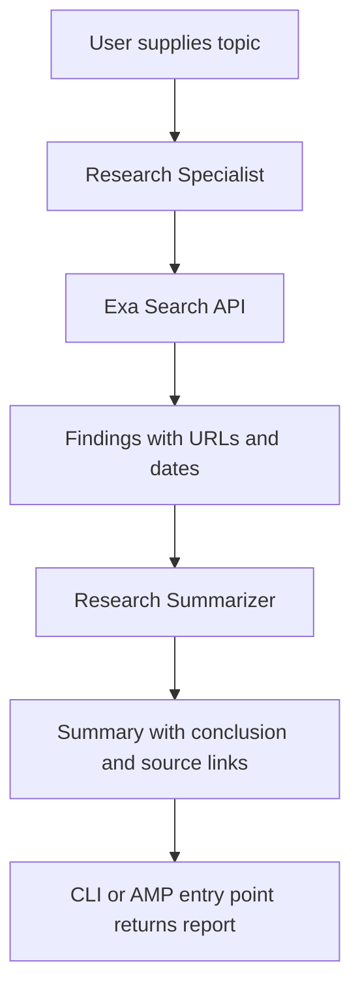

# Architecture

The user supplies a topic through the local CLI or a CrewAI entry point. The
Research Specialist uses Exa to retrieve current web results with source URLs
and dates when available. The Research Summarizer receives the research task's
output as context and writes the final report. Both agents use the configured
OpenAI model selected by `MODEL`.

Agent configuration is in `src/crewai_research_assistant/config/agents.yaml`,
task instructions and expected outputs are in `config/tasks.yaml`, and the
`@CrewBase` / sequential process wiring is in `crew.py`. Exa tool construction
is in `tools.py`; OpenAI model configuration is in `agents.py`.

## Internet search and model knowledge

The configured OpenAI model generates and summarizes text. It does not have
live access to the internet by itself. The Research Specialist calls Exa's
hosted Search API, and those returned highlights, publication dates, and URLs
are the live web evidence passed into its task. The prompt asks for current-year
results and dates; search engines can still return older pages or miss a new
page, so the report must disclose when it cannot find newer evidence. The
Summarizer only uses the research task context and does not search again.

The Exa request uses the official Python SDK's `exa.search(query, type="auto",
contents={"highlights": True})` pattern from the installed `build-with-exa`
skill. It does not add unrequested search filters. See [Exa tool](../src/crewai_research_assistant/tools.py),
the [skill source](https://github.com/exa-labs/agent-skills/tree/main/skills/build-with-exa),
and the [Exa Python SDK reference](https://exa.ai/docs/sdks/python-sdk-specification).
