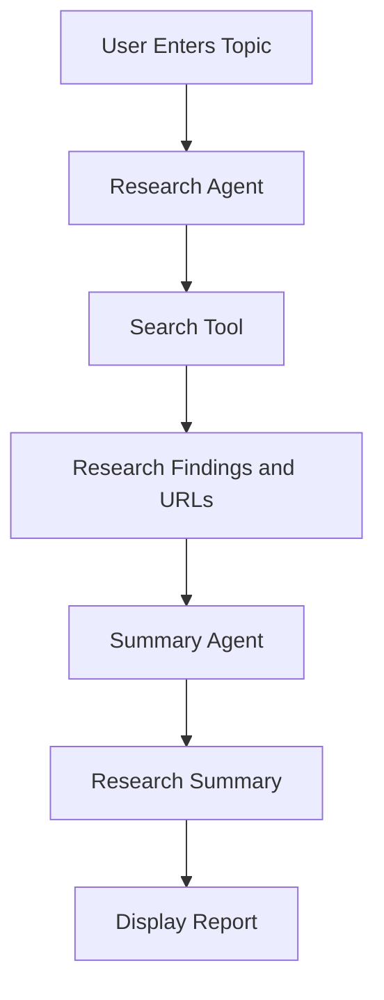

# Learn how to build a multi-agent AI application using CrewAI.

Create a small research assistant that takes a topic, searches for relevant information, and produces a short research summary with 
source links.

The goal is to understand how multiple AI agents work together to complete a task.

## Use Case

A user enters a topic such as:

> Latest developments in Model Context Protocol (MCP)

The application uses two AI agents:

- **Research Agent:** Finds relevant information from permitted web sources and collects source links.
- **Summary Agent:** Reads the research findings and creates a clear, structured summary.

The final output should contain the key findings, a short conclusion, and the sources used.

## Scope of Work

1.  **Learn CrewAI Fundamentals**

    Understand these concepts before building the application:

    - **Agent:** An AI worker assigned a specific role.
    - **Task:** An instruction describing what an agent must do.
    - **Crew:** A group of agents working together.
    - **Tool:** A function that allows an agent to perform an action, such as searching the web.
    - **Process:** Defines how tasks are executed, such as sequential execution.
    - **Output:** The result produced by an agent or task.

    Explain each concept in your own words in the repository documentation.

2.  **Create the Research Agent**

    Configure an agent with the role of Researcher.
    
    Responsibilities:

    - Research the user-provided topic.
    - Identify three to five useful findings.
    - Prefer official documentation and trustworthy sources.
    - Collect source URLs for the findings.
    - Avoid presenting unsupported claims as facts.
    - Use a suitable CrewAI search tool or a documented search API integration.

3.  **Create the Summary Agent**

    Configure a second agent with the role of Research Summarizer.
    
    Responsibilities:

    - Read the research collected by the first agent.
    - Remove repeated or irrelevant information.
    - Summarize the important findings in simple language.
    - Include source links.
    - Clearly mention when the available research is insufficient.

    The Summary Agent should use the Research Agent's output instead of conducting the same research again.

4.  **Connect the Agents Using a Crew**

    Configure a CrewAI crew with a sequential process.
    
    The workflow should be:

    - Accept the research topic.
    - Execute the research task.
    - Pass the research results to the summarization task.
    - Generate the final report.
    - Display the report to the user.

    Start with two agents only. Do not add extra agents unless the basic workflow works correctly.

5.  **Add Input Validation and Error Handling**

    Handle these cases:

    - The user submits an empty topic.
    - The search tool returns no useful results.
    - A source cannot be accessed.
    - The model or search API returns an error.
    - The generated summary contains no source links.

    Return clear error messages instead of crashing or silently producing an empty report.

6.  **Run Small Experiments**

    Test the application using at least five different topics.
    
    For each run, record:

    - Research topic.
    - Whether the research task completed.
    - Number of source links returned.
    - Whether the summary includes the main findings.
    - Execution time, if available.
    - Any errors or incorrect results.

    Include a short report describing what worked and what needs improvement.

## Architecture Diagram



## Required Repository Structure

Create a separate learning repository with this structure:

```text
crewai-research-assistant/
├── README.md
├── requirements.txt
├── .env.example
├── docs/
│   ├── crewai-concepts.md
│   ├── architecture.md
│   └── questions-and-answers.md
├── src/
│   ├── main.py
│   ├── agents.py
│   ├── tasks.py
│   ├── tools.py
│   └── crew.py
├── tests/
│   └── test_inputs.py
└── results/
    └── experiment-report.md
```

Keep the agents, tasks, tools, and crew configuration in separate files so the project is easy to understand and extend.

## Official Documentation

Use official documentation only. No videos are required.

- CrewAI documentation: CrewAI Documentation - CrewAI 
- CrewAI agents: Agents - CrewAI 
- CrewAI tasks: Tasks - CrewAI 
- CrewAI crews: Crews - CrewAI 
- CrewAI processes: Processes - CrewAI 
- CrewAI tools: Tools - CrewAI 
- CrewAI testing: Testing - CrewAI 
- Python environment variables: os — Miscellaneous operating system interfaces 
- Pytest documentation: pytest documentation 

Check the current CrewAI documentation for the correct imports and tool configuration for the installed version.

## Questions to Answer

Answer these questions in docs/questions-and-answers.md:

- What is CrewAI?
- What is the difference between an agent and a task?
- What is a crew?
- Why are two agents used instead of one agent doing everything?
- What does a sequential process do?
- How does the Summary Agent receive the Research Agent's findings?
- What is the purpose of a tool?
- How would you add another agent to verify the sources?
- What happens when the search tool fails?
- How would you reduce unnecessary model calls and execution costs?

## Acceptance Criteria

[ ] The application accepts a research topic from the user.
[ ] Two CrewAI agents are configured with clear responsibilities.
[ ] The Research Agent uses a search tool.
[ ] The Summary Agent generates a summary from the research findings.
[ ] The final report includes source URLs.
[ ] Input validation and basic error handling are implemented.
[ ] The application is tested with at least five topics.
[ ] The repository uses separate modules for agents, tasks, tools, and crew configuration.
[ ] The README explains installation, environment setup, and execution.
[ ] The architecture diagram and review questions are included.
[ ] API keys are stored in environment variables and are not committed to Git.

## Submission

Submit the GitHub repository link and include:

- A short explanation of how the two agents work together.
- One sample research report with source links.
- Results from five test topics.
- A list of errors encountered and how they were handled.
- Answers to the review questions.

## Definition of Done

The task is complete when another developer can follow the README, run the application, enter a topic, and receive a research summary 
with source links.

Focus on understanding the workflow rather than adding a frontend, database, extra agents, or complex infrastructure.